# Payroll System — Module Flow

```mermaid
flowchart TD

  %% ─── MASTER DATA ───────────────────────────────────────────────
  subgraph MASTER["⚙️ Master / Settings"]
    direction TB
    M1[Companies]
    M2[Departments]
    M3[Positions]
    M4[Employment Types]
    M5[Work Locations]
    M6[Attendance Settings\nwork hours / shift]
    M7[Holiday Calendar]
    M8[Day Offs\nweekday off]
    M9[Leave Types]
    M10[Banks]
    M11[Roles & Permissions]
  end

  %% ─── PAYROLL CONFIG ─────────────────────────────────────────────
  subgraph PCONFIG["💰 Payroll Config"]
    direction TB
    PC1[Earning Types]
    PC2[Deduction Types]
    PC3[Payroll Global Settings\nSSO rate / tax / etc.]
  end

  %% ─── EMPLOYEE SETUP ─────────────────────────────────────────────
  subgraph EMP["👤 Employee Setup"]
    direction TB
    E1[Employee\ncode / name / email / role\ndept / position / company]
    E2[Salary Structure\nbase salary + effective date]
    E3[Employee Earnings\nrecurring allowances]
    E4[Employee Deductions\nrecurring deductions]
  end

  %% ─── ATTENDANCE ─────────────────────────────────────────────────
  subgraph ATT["📅 Attendance"]
    direction TB
    A1[Time Logs\ncheck-in / check-out]
    A2[Leave Requests]
    A3[Leave Approved]
  end

  %% ─── PAYROLL CYCLE ───────────────────────────────────────────────
  subgraph CYCLE["🔄 Payroll Cycle"]
    direction TB
    CY1[Payroll Cycle\ndefine period + company]
    CY2[Run Payroll\ncalculate net pay]
    CY3[Cycle Earnings\nadjust / add earnings]
    CY4[Cycle Deductions\nadjust / add deductions]
  end

  %% ─── OUTPUT ──────────────────────────────────────────────────────
  subgraph OUT["📊 Output"]
    direction TB
    O1[Transactions\nper employee net pay record]
    O2[Payslips Report]
    O3[Bank Transfer Report]
    O4[Tax Forms Report]
    O5[SSO Report]
    O6[Payroll Analysis\nearning / deduction summary]
  end

  %% ─── CONNECTIONS ─────────────────────────────────────────────────

  %% Master → Employee
  M1 -->|"company scope"| E1
  M2 -->|"dept"| E1
  M3 -->|"position"| E1
  M4 -->|"employment type"| E1
  M11 -->|"role / permissions"| E1

  %% Master → Attendance rules
  M6 -->|"shift / work hours"| A1
  M7 -->|"paid / unpaid holidays"| A1
  M8 -->|"off days"| A1
  M9 -->|"leave quota"| A2

  %% Employee → Attendance
  E1 -->|"employee"| A1
  E1 -->|"employee"| A2
  A2 --> A3

  %% Employee Setup
  E1 --> E2
  E1 --> E3
  E1 --> E4

  %% Payroll Config → Cycle
  PC1 -->|"earning type"| E3
  PC2 -->|"deduction type"| E4
  PC1 -->|"earning type"| CY3
  PC2 -->|"deduction type"| CY4
  PC3 -->|"global rates"| CY2

  %% Master → Cycle
  M1 -->|"company"| CY1
  M5 -->|"work location"| CY1
  M10 -->|"bank info"| O3

  %% Everything → Run Payroll
  CY1 --> CY2
  E2 -->|"base salary"| CY2
  E3 -->|"recurring earnings"| CY2
  E4 -->|"recurring deductions"| CY2
  A1 -->|"actual hours worked\nOT / late / absent"| CY2
  A3 -->|"approved leave days"| CY2
  CY3 -->|"cycle-level adjustment"| CY2
  CY4 -->|"cycle-level adjustment"| CY2

  %% Run Payroll → Output
  CY2 --> O1
  O1 --> O2
  O1 --> O3
  O1 --> O4
  O1 --> O5
  O1 --> O6

  %% ─── STYLES ──────────────────────────────────────────────────────
  classDef master fill:#f0effe,stroke:#6259ca,color:#1e293b
  classDef pconfig fill:#fef9c3,stroke:#ca8a04,color:#1e293b
  classDef emp fill:#dcfce7,stroke:#16a34a,color:#1e293b
  classDef att fill:#dbeafe,stroke:#2563eb,color:#1e293b
  classDef cycle fill:#fff7ed,stroke:#ea580c,color:#1e293b
  classDef out fill:#fce7f3,stroke:#db2777,color:#1e293b

  class M1,M2,M3,M4,M5,M6,M7,M8,M9,M10,M11 master
  class PC1,PC2,PC3 pconfig
  class E1,E2,E3,E4 emp
  class A1,A2,A3 att
  class CY1,CY2,CY3,CY4 cycle
  class O1,O2,O3,O4,O5,O6 out
```



---

## Flow Summary (Text)

```
Master / Settings
  ├── Companies, Departments, Positions, Employment Types
  │     └──→ Employee (defines WHO, WHERE, WHAT role)
  ├── Attendance Settings, Holidays, Day Offs
  │     └──→ Time Logs (defines valid work hours & off days)
  └── Leave Types
        └──→ Leave Requests → Leave Approved

Payroll Config
  ├── Earning Types   ──→ Employee Earnings (recurring)
  ├── Deduction Types ──→ Employee Deductions (recurring)
  └── Global Settings ──→ SSO rate, tax bracket, etc.

Employee Setup
  ├── Employee record
  ├── Salary Structure (base salary, effective date)
  ├── Employee Earnings (recurring allowances)
  └── Employee Deductions (recurring cuts)

Attendance
  ├── Time Logs (actual hours, OT, late, absent)
  └── Approved Leaves (paid/unpaid leave days)

          ↓↓↓ ALL OF THE ABOVE FEEDS INTO ↓↓↓

Payroll Cycle
  1. Define Cycle (period + company)
  2. Add Cycle-level Earnings / Deductions (one-off adjustments)
  3. Run Payroll → net pay per employee

          ↓↓↓ OUTPUT ↓↓↓

Transactions (per-employee net pay record)
  ├── Payslips Report
  ├── Bank Transfer Report
  ├── Tax Forms (ภ.ง.ด.)
  ├── SSO Report (ประกันสังคม)
  └── Payroll Analysis (summary charts)
```
